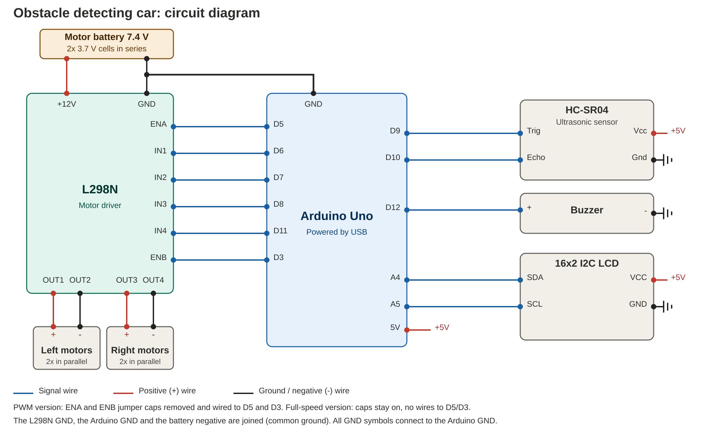

# Obstacle Detecting Car

A 4WD robot car that detects obstacles with an ultrasonic sensor and steers itself around them. Built by three ECE students using an Arduino Uno.

The car measures the distance ahead several times a second and shows it on a 16x2 LCD. When an obstacle gets too close, it stops, reverses and turns away to find a clear path.

## How it works

The HC-SR04 ultrasonic sensor measures the distance in front of the car. The Arduino takes the median of three readings to filter out noise, then decides what to do:

| Distance | Behaviour | LCD status |
|---|---|---|
| Over 40 cm | Drives forward | Path clear |
| 20 to 40 cm | Warning beep from the buzzer | Warning |
| Under 20 cm | Stops, reverses, then turns away | Obstacle! Stop |

Turning uses differential steering: one side's wheels stop while the other side keeps running, so the car pivots around the stopped side.

## Hardware

| Component | Quantity | Purpose |
|---|---|---|
| Arduino Uno | 1 | Controller |
| HC-SR04 ultrasonic sensor | 1 | Distance sensing |
| 16x2 LCD with I2C backpack | 1 | Live distance and status display |
| L298N motor driver | 1 | Drives the motors |
| DC gear (TT) motors with wheels | 4 | Drive wheels, wired as left and right pairs |
| 4WD chassis | 1 | Frame |
| 2x 3.7 V Li-ion cells in series (7.4 V) | 1 set | Motor battery |
| Active buzzer | 1 | Warning sound |
| Jumper wires, breadboard, switch | - | Connections |

## Wiring

The motors run from a separate battery. The Arduino is powered over USB (or its own supply). All grounds must be joined: battery, L298N and Arduino.

### Power

| From | To |
|---|---|
| Motor battery + (through switch) | L298N +12V |
| Motor battery - | L298N GND |
| L298N GND | Arduino GND (common ground) |

Keep the 5V-EN jumper on the L298N fitted, and do not connect the L298N 5V terminal to the Arduino.

### L298N to Arduino

| L298N pin | Arduino pin |
|---|---|
| IN1 | D6 |
| IN2 | D7 |
| IN3 | D8 |
| IN4 | D11 |
| ENA | D5 (PWM version) or jumper cap on (full-speed version) |
| ENB | D3 (PWM version) or jumper cap on (full-speed version) |

Never connect a wire to ENA or ENB while its jumper cap is still fitted.

### Motors to L298N

| L298N terminal | Motors |
|---|---|
| OUT1 (+) / OUT2 (-) | Left front and left rear, wired in parallel |
| OUT3 (+) / OUT4 (-) | Right front and right rear, wired in parallel |

If a side drives the wrong way, swap that side's two wires at the terminals.

### Ultrasonic sensor (HC-SR04)

| Sensor pin | Arduino pin |
|---|---|
| Vcc | 5V |
| Trig | D9 |
| Echo | D10 |
| Gnd | GND |

### LCD (16x2 I2C)

| LCD pin | Arduino pin |
|---|---|
| VCC | 5V |
| GND | GND |
| SDA | A4 |
| SCL | A5 |

### Buzzer

| Buzzer pin | Arduino pin |
|---|---|
| + (long leg) | D12 |
| - | GND |

## Circuit diagram

## Code

Two versions are provided. Use the one that matches how you wired ENA and ENB.

| Sketch | ENA / ENB | Behaviour |
|---|---|---|
| `firmware/obstacle_car_fullspeed/obstacle_car_fullspeed.ino` | Jumper caps on, no wires | Always runs at full speed |
| `firmware/obstacle_car_pwm/obstacle_car_pwm.ino` | Caps removed, wired to D5 and D3 | Slows down near obstacles using PWM |

### Setup

1. Install the Arduino IDE.
2. Install the **LiquidCrystal I2C** library (by Frank de Brabander) from Sketch > Include Library > Manage Libraries.
3. Open the sketch, select Tools > Board > Arduino Uno and the correct port.
4. Upload with the motor battery switched off, then switch the battery on.

### Tuning

Edit the constants at the top of the sketch:

| Constant | Meaning |
|---|---|
| `STOP_DIST_CM` | Distance at which the car stops and avoids (default 20) |
| `WARN_DIST_CM` | Distance at which the warning starts (default 40) |
| `CRUISE_SPEED`, `SLOW_SPEED`, `TURN_SPEED` | Motor speeds, 0 to 255 (PWM version) |
| `BACK_TIME_MS`, `TURN_TIME_MS` | How long the car reverses and turns |

## Troubleshooting

| Problem | Likely cause |
|---|---|
| `LiquidCrystal_I2C.h: No such file or directory` | Library not installed |
| LCD is blank | Change the I2C address from `0x27` to `0x3F`, or adjust the contrast screw on the back |
| Upload fails | Check the board, port and USB cable. Disconnect anything on D0 and D1 |
| Motors do not move | Check the common ground, the motor battery voltage (about 7 V or more), the ENA/ENB caps and the IN wires |
| A side runs backwards | Swap that side's two motor wires |
| Distance always reads 400 | Trig and Echo wires may be swapped |

## Future improvements

- Servo-mounted sensor to scan left and right and turn toward the clearer side
- Rear sensor for safe reversing
- Bluetooth control

## Team

- Prathyumnan R
- Sudarsini M L 
- Thilaga Devi C

## License

Released under the MIT License.
